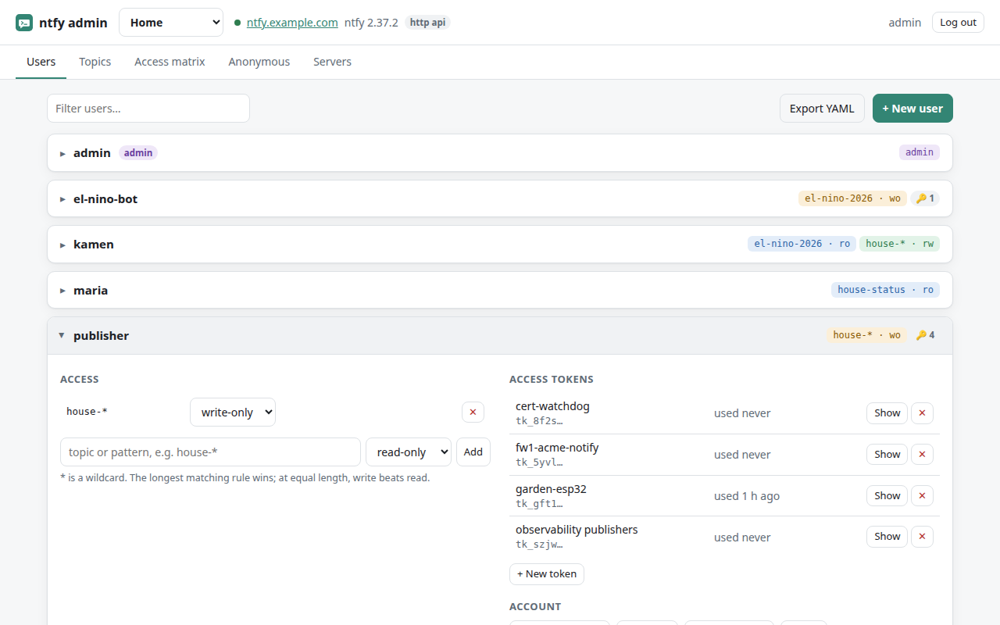
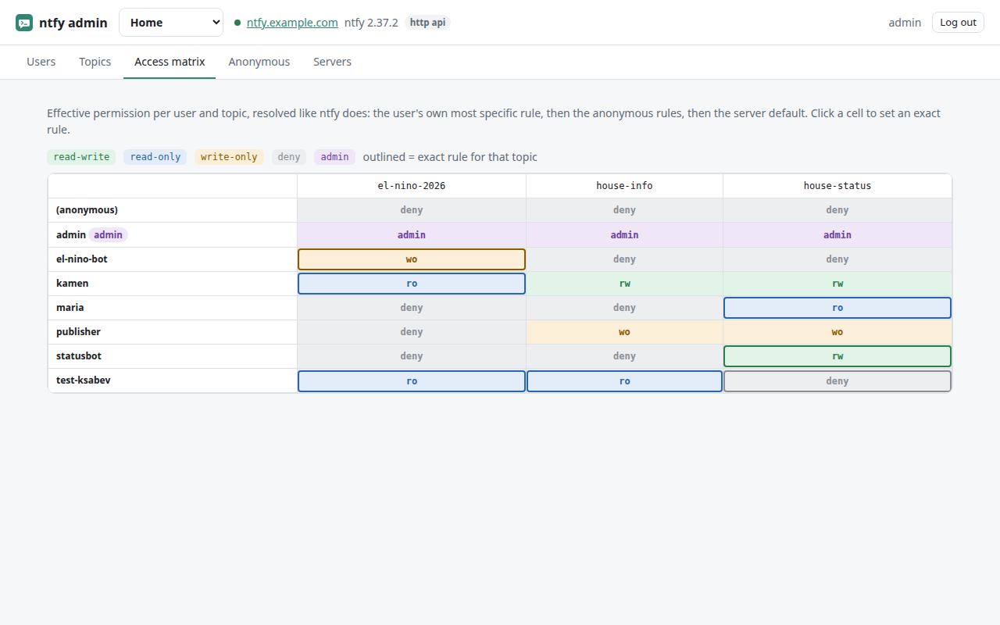
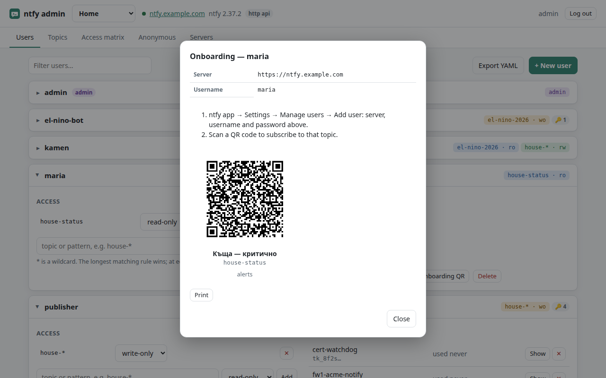
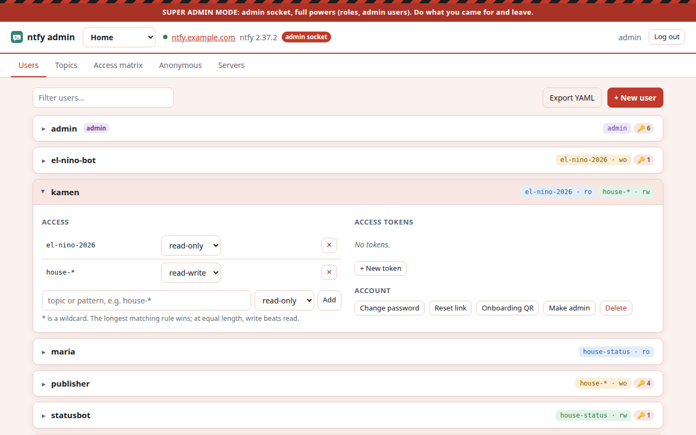

# ntfy-admin

[](https://github.com/ksabev/ntfy-admin/actions/workflows/ci.yml)
[](LICENSE)

**The admin page that self-hosted [ntfy](https://ntfy.sh) never had.**

ntfy has users, access rules and access tokens, but its web app only manages
*your own* account. Everything else needs the CLI inside the container. ntfy-admin
is a small web panel for the rest: create users, grant topics, hand out tokens, and
onboard a phone with a QR code. It works across one ntfy server or several.



## What it does

- **Users:** create, delete, set or generate passwords, password reset links, roles, tiers.
- **Access rules:** per user and for anonymous visitors, with `*` wildcards.
- **Access matrix:** the effective permission for every user and topic, resolved the
  way ntfy resolves it. Click a cell to set a rule.
- **Access tokens:** one per device or service, with label and expiry, last used
  time and IP, one-click revoke. Values stay hidden until you click *Show*.
- **Onboarding card:** server, username, a fresh password and one QR code per readable
  topic. Scan it and the ntfy app is subscribed. Printable.
- **Topics:** who can read, who can publish, display names for the phone app, test message.
- **Many servers:** add, edit and remove ntfy servers in the UI, each with its own admin login.
- **Super admin mode:** a second, deliberately red panel that uses ntfy's admin socket
  for what ntfy refuses over HTTP: roles and admin users.
- **Export:** who-can-what as YAML, for docs or git. No passwords, no token values.

| | | |
|---|---|---|
|  |  |  |
| Access matrix | Onboarding card | Super admin mode |

## How it works

ntfy-admin is a thin layer over **ntfy's own admin API**. It keeps no user database
and stores no secrets. You log in with an ntfy admin account; the panel trades your
password for a short-lived ntfy token and forgets the password. It needs no Docker
socket and no access to ntfy's files.

It ships as a single static Go binary with a plain HTML/JS UI (no build step, no
npm). The distroless image is about 10 MB, runs as non-root, and is published for
amd64, arm64 and armv7 (Raspberry Pi): `ghcr.io/ksabev/ntfy-admin`.

**Requires ntfy 2.36 or newer** for everything. On older servers, users and access
rules still work and token management switches itself off.

## Quick start

```yaml
services:
  ntfy:
    image: binwiederhier/ntfy:v2.37.2
    command: ["serve"]
    environment:
      NTFY_BASE_URL: https://ntfy.example.com
      NTFY_AUTH_FILE: /var/lib/ntfy/user.db
      NTFY_AUTH_DEFAULT_ACCESS: deny-all
    volumes:
      - ./ntfy:/var/lib/ntfy
    ports: ["8082:80"]

  ntfy-admin:
    image: ghcr.io/ksabev/ntfy-admin:latest
    environment:
      NTFY_ADMIN_NTFY_URL: http://ntfy:80                 # how the panel reaches ntfy
      NTFY_ADMIN_PUBLIC_URL: https://ntfy.example.com     # how phones reach ntfy (QR codes)
    volumes:
      - ./ntfy-admin:/data                                # chown 65532 ./ntfy-admin
    ports: ["8083:8080"]
```

```sh
docker compose up -d
docker compose exec ntfy ntfy user add --role=admin admin     # the one admin you need to start
```

Open http://localhost:8083 and log in. The full setup, including the super admin
panel, is in [docker-compose.example.yml](docker-compose.example.yml).

## Documentation

| | |
|---|---|
| [Installation](docs/install.md) | Docker, reverse proxies, the super admin panel, permissions, upgrades |
| [Adding servers](docs/servers.md) | Getting a new ntfy server ready, and how logging in to it works |
| [Using the panel](docs/usage.md) | Users, rules, tokens, onboarding, topics, matrix, export |
| [Migrating from `auth-users`](docs/migrate-from-provisioning.md) | Moving users from ntfy's config file into the panel, without changing any password or token |
| [Security](docs/security.md) | What the panel can do, how logins work, how to expose it |
| [Development](docs/development.md) | Architecture, HTTP API, tests, building |

## License

[Apache-2.0](LICENSE). Not affiliated with the ntfy project.
