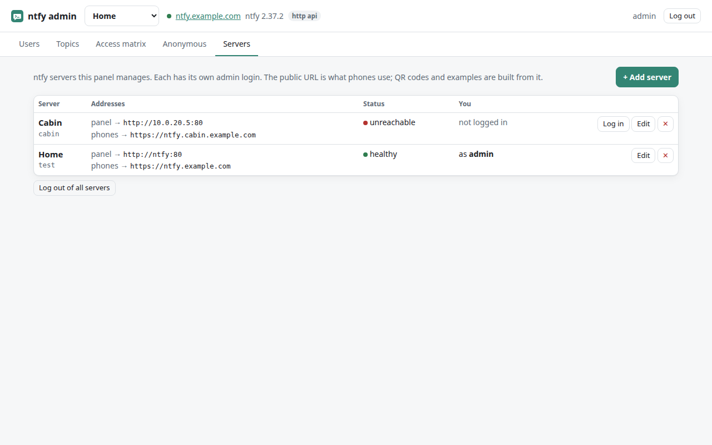
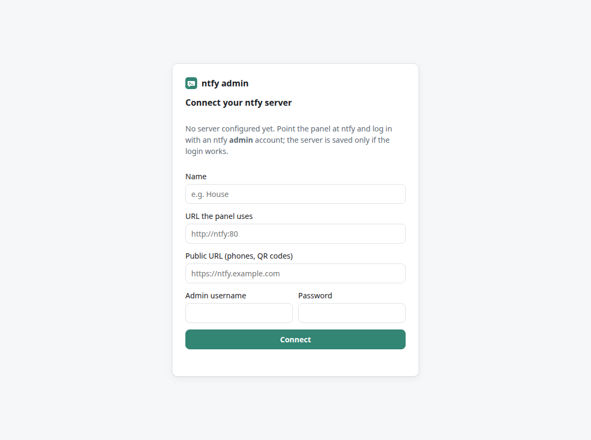

# Adding servers

One panel can manage several ntfy servers: home, a cabin, a test box. Each server
has its own admin accounts, and you log in to each one separately.



## How logging in works

The panel keeps no passwords and has no accounts of its own. **To manage a server,
you need an admin account on that server.**

1. You enter the server's admin username and password in the panel.
2. The panel asks ntfy whether the account exists and has the `admin` role
   (`GET /v1/account`).
3. If it does, the panel creates a short-lived ntfy access token for that account,
   labelled `ntfy-admin session`. From then on it talks to ntfy with that token, and
   the password is forgotten.
4. When you log out (or the session expires, 12 h by default), the token is deleted.
   You can spot these tokens in the token list by their *panel login* badge.

One browser can be logged in to several servers at once. Switch between them with
the menu at the top, or from the *Servers* tab.

## Getting a new ntfy server ready

On the new server, once:

1. **ntfy 2.36 or newer**, with auth enabled:
   ```yaml
   auth-file: /var/lib/ntfy/user.db
   auth-default-access: deny-all
   ```
2. **One admin account.** The admin API cannot create the first admin, so use the CLI:
   ```sh
   docker exec -e NTFY_PASSWORD='choose-something' <ntfy-container> ntfy user add --role=admin admin
   ```
   (Without Docker: `NTFY_PASSWORD=… ntfy user add --role=admin admin`.)
3. **Network:** the panel must be able to reach the server. It can use either the
   internal address (`http://10.0.20.5:80`) or the public one (`https://ntfy.cabin.example.com`).
4. Optional, for super admin on that server: enable the admin socket
   (`experimental-listen-admin-unix: /run/ntfy/admin.sock`). The socket only helps a
   super panel **on the same host**, because it is a local file. Remote servers are
   managed over HTTP: everything except roles and admin users.

Then, in the panel:

1. **Servers → + Add server**
   - **Name:** shown in the server menu.
   - **URL the panel uses:** how the panel container reaches ntfy.
   - **Public URL:** how phones reach ntfy. QR codes and examples use it.
   - **Admin socket** (super panel only): path inside the super panel's container.
   - The panel checks that ntfy answers at the URL before saving. Tick *Save even if
     the server does not answer* to add one that is down right now.
2. **Log in** next to the new server, with the admin account from step 2 above.

## Very first start

If the panel has no servers (no `servers.json`, no seed variables), it opens a setup
screen. It asks for the URLs and an admin login, and saves the server **only if the
login works**. Until then, nobody can add a server without proving they are an admin
of it.



## Editing and removing

- Changing a server's **name or public URL** does not affect logins.
- Changing its **URL or socket** logs everyone out of that server first, so no session
  token is ever sent to a different target.
- **Removing** a server only removes it from the panel and deletes the panel's own
  session tokens for it. Nothing else changes on the ntfy server.

Any logged-in admin can change the server list. If several people or teams share one
panel, set `NTFY_ADMIN_LOCK_SERVERS=true` and manage `servers.json` yourself (see
[installation](install.md#configuration)).
