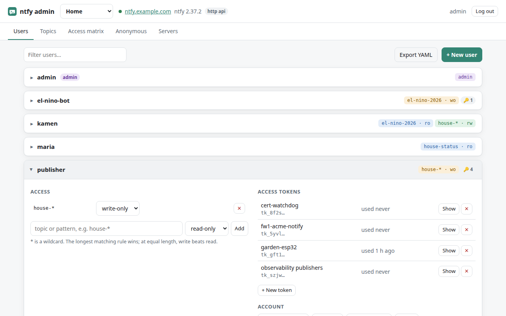
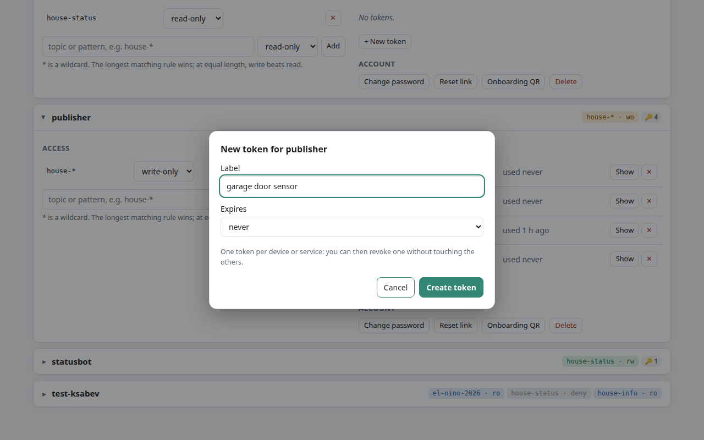
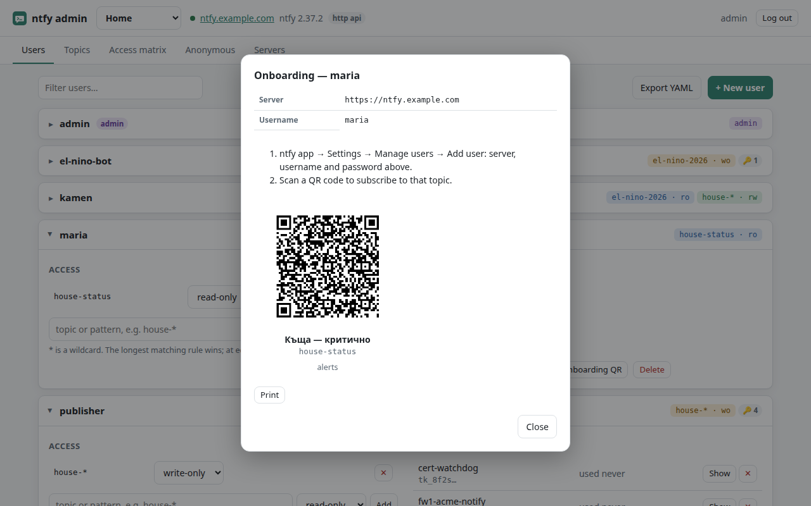
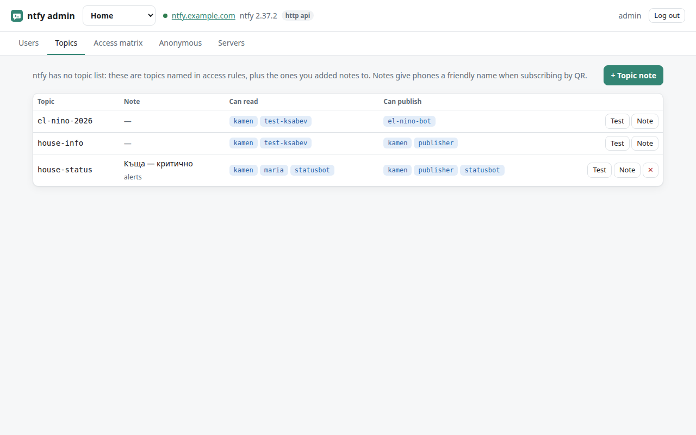
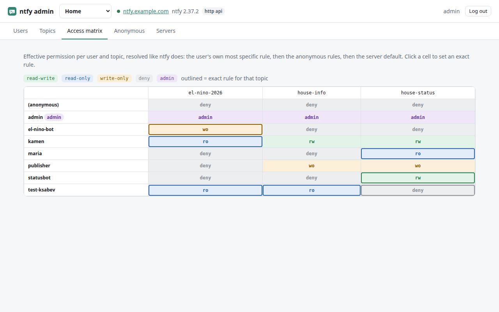
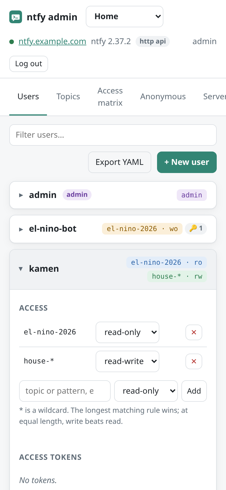

# Using the panel

## Users

Click a user to open it.

- **Access:** the user's rules. Pick a topic or a pattern (`house-*`) and a permission:
  `read-write`, `read-only`, `write-only` or `deny`. Changing the drop-down saves at once.
- **Access tokens:** see [Tokens](#access-tokens).
- **Change password:** generate one (20 characters, shown once) or type your own
  (8+ characters). The onboarding card opens afterwards with the new password on it.
- **Reset link:** a one-time ntfy link where the user picks a new password themselves.
  It also comes as a QR code. It is built from ntfy's `base-url`.
- **Onboarding QR:** the card without a password, for a new phone of an existing user.
- **Make admin / Make regular user:** super panel only.
- **Delete:** removes the user, their rules and their tokens. Devices using them stop
  working immediately.

**+ New user** asks for a name, a password (generated or your own) and optionally a
first rule. The onboarding card follows.

Rules on **admin** users have no effect: admins can read and write every topic.

### Users from ntfy's config file

Users, rules and tokens defined in ntfy's `server.yml` (`auth-users`, `auth-access`,
`auth-tokens`) are *provisioned*. ntfy rebuilds them on every start and refuses to
change them through the API. The panel marks them *provisioned* and disables their
buttons. To manage them here, see [migrating from auth-users](migrate-from-provisioning.md).

## Access tokens

Give each device or service its own token (*garage door sensor*, *alertmanager
bridge*). Then you can revoke one without touching the others, and *used 3 min ago
from 10.0.20.17* tells you which one is still alive.

- **+ New token:** a label and an optional expiry (30 days, 90 days, 1 year).
- **Show:** fetches the value from ntfy, with a ready-made `curl` line that publishes
  to a topic the user can write to. Every *Show* is written to the audit log.
- **✕:** revokes the token at once.

The token list never contains token values, only the first characters.

## Onboarding a phone

1. In the ntfy app: **Settings → Manage users → Add user**, with the server,
   username and password from the card.
2. Scan a QR code. The app opens and subscribes to that topic, showing the topic's
   display name.

The card shows one QR per topic the user can read, including topics they reach
through a pattern. A topic only counts if the panel knows its name: it is named in a
rule, or it has a topic note. *Print* gives a paper version. With more than three
topics the codes get smaller; click one to show it alone and large, so the phone
doesn't scan the one next to it.

**One user per server on a phone.** The ntfy app keeps a single login per server, and
all topics of that server share one connection. Adding a second user for the same
server replaces the first, ntfy then refuses the whole connection, and every topic
stops (the app reports it as a WebSocket error). To give a phone another topic, grant
access to the user already on it.

ntfy can't import a login from a QR code. The one-time login is typed in; after
that, every subscription is a scan.

## Topics

ntfy has no list of topics: a topic exists when someone publishes to it. The *Topics*
tab shows topics named in rules, plus topics you added a **note** to. A note has two
parts:

- **Display name:** what the phone app shows after a QR subscription.
- **About:** a line for people, such as "door sensors, quiet".

*Test* publishes a message to the topic as you. Notes are stored by the panel (per
server), not by ntfy.

## Access matrix

The matrix shows every user against every known topic, with the permission that
actually applies. It follows ntfy's rules:

1. Admins can do everything.
2. Otherwise the user's own rules: the longest matching pattern wins, and at equal
   length the one that allows writing wins.
3. If none of their own rules match, the anonymous (`*`) rules, resolved the same way.
4. If nothing matches, the server's `auth-default-access`.

Hover a cell to see which rule decided it. An outlined cell has an exact rule for that
topic. Click any cell to set or remove one.

## Anonymous

Rules for visitors who are not logged in, plus the server's default access. Logged-in
users fall back to these rules when none of their own match. ntfy's API cannot change
the default access; it comes from ntfy's config.

## Export

*Export YAML* on the Users tab downloads who can do what on the current server: users,
roles, rules, token labels and topic notes. It contains no passwords and no token
values, so you can commit it as documentation or diff it over time.

## Phones and narrow screens

The layout works on a phone, for adding a user or revoking a token on the spot.

